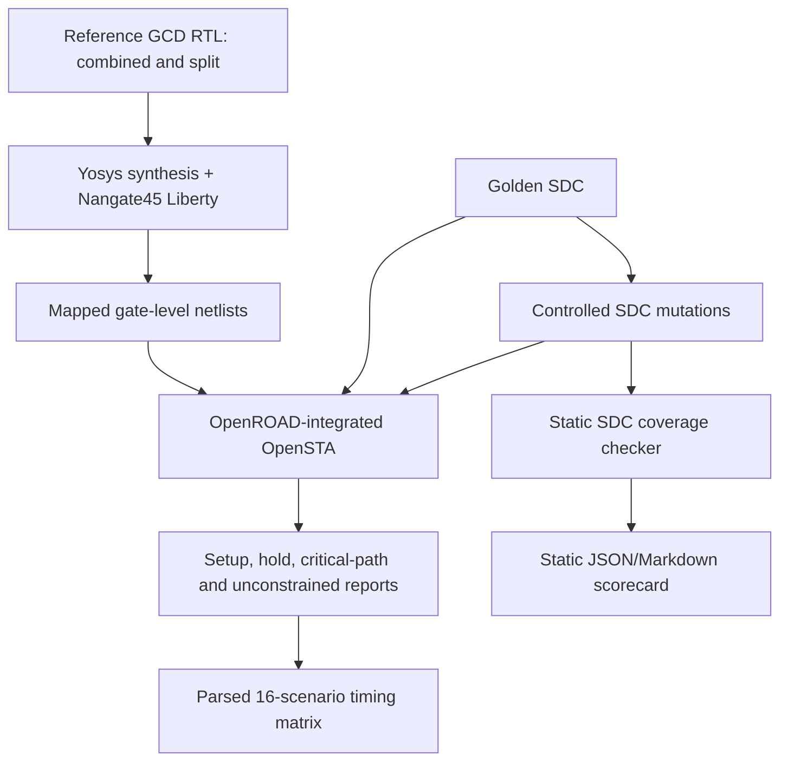

[](https://github.com/arshath-007/timingforge-gcd-sta-lab/actions/workflows/rtl-regression.yml)
[](https://github.com/arshath-007/timingforge-gcd-sta-lab/actions/workflows/formal-equivalence.yml)
[](https://github.com/arshath-007/timingforge-gcd-sta-lab/actions/workflows/physical-design.yml)

# TimingForge
## An Open Benchmark for Trustworthy Static Timing Analysis

**Status:** Research prototype · **Version:** 0.4.0 candidate · **Latest published release:** v0.2.1 · **License:** MIT

> A timing report can look clean even when the constraints are incomplete. TimingForge studies whether an STA flow can identify deliberately introduced constraint defects before engineers trust its results.

TimingForge is an educational, reproducible benchmark for **constraint quality and timing-analysis trust**. It uses two 32-bit binary-GCD RTL architectures as a controlled test vehicle, injects named SDC defects, runs a conservative constraint-coverage checker, and analyses the golden/mutated constraints with a library-backed OpenROAD-integrated OpenSTA flow.

This is not a replacement for signoff STA, an official EDA signoff qualification, or a claim that an unconstrained path is automatically a silicon failure. It is a research and learning framework that makes assumptions visible and experiments reproducible.

## Why this problem matters

Static timing analysis is only as meaningful as the design model and timing constraints supplied to it. Missing clocks or I/O delays, incorrect port matches, and unjustified timing exceptions can leave paths unconstrained or excluded. A positive slack value is not sufficient evidence that all intended paths were analysed.

TimingForge makes this failure mode testable:

1. Establish a reference RTL and SDC baseline, documenting any observed setup or hold violations.
2. Generate controlled, named SDC mutations from that baseline.
3. Run static constraint-coverage checks.
4. Synthesize both RTL architectures against the same standard-cell Liberty library.
5. Run the golden and mutated SDC files through the same timing engine and netlist.
6. Compare setup/hold results, unconstrained endpoints, critical paths, and register-to-register path coverage.
7. Publish every assumption and result rather than inventing PPA numbers.

## Architecture



The static checker is a conservative, interface-specific prototype—not a full SDC Tcl parser. The library-backed matrix uses Yosys, the OpenROAD-integrated OpenSTA engine, and the educational Nangate45 typical Liberty platform.

## Core features

- Two synthesizable iterative binary-GCD microarchitectures: combined compare/subtract and split compare/subtract.
- A self-checking SystemVerilog testbench using a Euclidean-algorithm reference model.
- Additional parameterized synchronous FIFO and signed MAC accumulator blocks with directed SystemVerilog regression tests (functional extension; not yet part of the GCD STA matrix).
- A documented 10 ns block-level SDC example with setup/hold uncertainty and min/max I/O delays.
- Seven controlled SDC mutation cases:
  - M01 missing primary clock.
  - M02 missing input delay.
  - M03 missing output delay.
  - M04 broad register-to-register false-path exception.
  - M05 near-match/incorrect port collection.
  - M06 missing hold clock uncertainty.
  - M07 non-positive clock period.
- Static SDC coverage checker, fault generator, JSON/Markdown scorecard, and Python unit tests.
- Yosys synthesis scripts and a library-backed OpenROAD-integrated STA matrix runner.
- STA report parser that summarises area, minimum clock period, Fmax, worst setup/hold slack, WNS/TNS, register-to-register path presence, unconstrained endpoints, heuristic critical-path classes, and OpenSTA max-slew/max-capacitance/max-fanout violation records.
- Phase 1 quality findings, SDC mutation impact scoring, and reproducible clock-uncertainty/source-latency sensitivity experiments.
- Conservative golden-result quality checks that flag missing metrics, unconstrained endpoints, missing I/O delays, negative hold slack, and unavailable native register-only period without inventing a derived Fmax.
- GitHub Actions regression and library-backed STA jobs.

## Repository layout

```text
rtl/             synthesizable GCD architectures plus FIFO/MAC extension blocks
tb/              self-checking GCD, FIFO and MAC SystemVerilog testbenches
constraints/     golden SDC
tools/           fault injector, SDC linter, STA/QoR and physical-evidence parsers
tests/           Python unit tests for STA, QoR, and physical evidence
scripts/         synthesis, formal, OpenSTA and OpenROAD entry points
formal/          bounded transaction-equivalence miter and SymbiYosys config
physical/        paired Nangate45 ORFS design configurations
docs/            scope, fault catalog, verification and physical results
reports/         generated reports (not committed by default)
.github/         automated RTL/Python and library-backed STA workflows
```

## Quick start

### 1. Functional RTL regression

Requirements: Icarus Verilog with SystemVerilog support.

```bash
make rtl-test
make ip-block-test
```

### 2. Static SDC fault-injection benchmark

Requirements: Python 3.10+.

```bash
make mutants
make lint-sdc
make python-test
make benchmark
python3 -m unittest discover -s tests -p 'test_quality_checks.py' -v
```

Generated SDC files are written under `build/mutants/`. The checker validates simple expected clock, setup/hold uncertainty, and min/max I/O-delay patterns for the GCD interface. The benchmark writes JSON and Markdown scorecards under `build/`; its score covers seven controlled pattern/coverage mutations only, not general SDC correctness or signoff.

### 3. Library-backed synthesis and timing matrix

Requirements: OpenROAD Flow Scripts environment with Yosys, OpenROAD-integrated OpenSTA, Python 3, and curl.

```bash
source /OpenROAD-flow-scripts/env.sh
make sta-matrix
make sensitivity
python3 -m tools.quality_checks build/reports/sta_matrix_summary.json --output build/reports/sta_quality_findings.json
```

The script downloads the Nangate45 typical Liberty and two LEF files from a pinned OpenROAD Flow Scripts source revision when they are not present. It synthesizes both GCD architectures and runs the golden SDC plus seven mutations through the timing engine (16 STA runs total). It then writes:

- `build/reports/sta_matrix_summary.md`
- `build/reports/sta_matrix_summary.json`
- `build/reports/sta_quality_findings.json`
- `build/reports/sta_mutation_impact.json`
- `build/sensitivity/sensitivity_summary.json` plus generated SDC variants
- Raw baseline and sensitivity STA logs in `build/reports/`
- Yosys synthesis logs in `build/`

The summary separates register-to-register minimum period/Fmax from all-path minimum period/Fmax (which includes I/O port paths), and includes Yosys cell area, worst setup/hold slack, WNS/TNS, path presence, missing I/O-delay warnings, and unconstrained endpoints. The supported matrix flow uses the OpenROAD-integrated OpenSTA executable (`openroad`) and its LEF-aware setup.

### 4. Manual synthesis and STA

For a locally configured standard-cell library:

```bash
export LIBERTY=/absolute/path/to/your/stdcells.lib
make synth
export NETLIST=build/gcd_binary_combined.v
export SDC=constraints/gcd_baseline.sdc
make sta
```

Review the raw Yosys/OpenSTA logs and tool versions. A successful script exit alone is not a substitute for understanding the reported paths and constraints.

## Verified evidence

The v0.2.0 release was validated by [GitHub Actions run #160](https://github.com/arshath-007/timingforge-gcd-sta-lab/actions/runs/42015328699), source commit `bdd42621749035fa088e326c766f3af8031af337`. Both RTL/Python regression and the 16-run Nangate45 STA matrix passed.

- Two synthesizable GCD architectures evaluated.
- Seven defined SDC fault patterns detected (7/7).
- Both architectures synthesized against the pinned Nangate45 typical Liberty file.
- Eight SDC scenarios analysed per architecture (16 STA logs).
- Corrected golden output loads: 20 fF on scalar outputs and 30 fF on the GCD output bus.
- Combined: 1657.180 area units, 2.94 ns all-path period, 340.67 MHz all-path Fmax, +7.065 ns worst setup slack and -0.002 ns worst hold slack.
- Split: 1681.918 area units, 2.35 ns all-path period, 425.57 MHz all-path Fmax, +7.650 ns worst setup slack and +0.005 ns worst hold slack.
- All-path period includes I/O port paths. These figures are not a register-to-register-only architecture speed comparison.
- Split register-to-register minimum period: 0.740 ns. The equivalent combined-design minimum-period query returned no usable measurement, although a separate path report finds register-to-register paths.
- Latency figures are finite-corpus observations, not proven worst-case bounds.

Download the [STA matrix artifact](https://github.com/arshath-007/timingforge-gcd-sta-lab/actions/runs/42015328699/artifacts/13408368824) and [static benchmark artifact](https://github.com/arshath-007/timingforge-gcd-sta-lab/actions/runs/42015328699/artifacts/13408887449).

## Phase 1 reliability evidence — v0.3.0 candidate

The Phase 1 implementation is merged to `main`. The final feature-branch validation [run #257](https://github.com/arshath-007/timingforge-gcd-sta-lab/actions/runs/42046659049) and post-merge main validation [run #258](https://github.com/arshath-007/timingforge-gcd-sta-lab/actions/runs/42047005600) both passed regression and library-backed STA. The [run #258 STA artifact](https://github.com/arshath-007/timingforge-gcd-sta-lab/actions/runs/42047005600/artifacts/13425391627) contains raw logs and machine-readable results.

- 18 clock-sensitivity experiments completed: nine constraint variants for each GCD architecture.
- SDC mutation impact: 12 matched, 0 mismatched, 2 inconclusive. Both inconclusive observations are M06 because the current reports do not directly expose whether hold uncertainty was applied.
- Baseline DRV violation records: combined GCD — 10 max-slew and 15 max-capacitance; split GCD — 9 max-slew and 15 max-capacitance. No max-fanout violation records were emitted; the violator-only report does not enumerate total applicable checks.
- Golden quality findings: REVIEW, with five warnings and three informational findings. The combined design retains -0.002 ns hold slack, and its native register-only minimum-period metric remains unavailable.
- These are pre-layout Nangate45 typical-corner results with ideal clocks and no SPEF. No physical-design or signoff claim is made.

See [Phase 1 diagnostics and measured sensitivity](docs/PHASE1_DIAGNOSTICS.md) and the [updated interview guide](docs/INTERVIEW_GUIDE.md).

The current main-branch extension and diagnostic changes passed both CI jobs in [run #196](https://github.com/arshath-007/timingforge-gcd-sta-lab/actions/runs/42029353553) at commit `30b7a7bcf862762627935813a31330efa85a1eff`. Its [latest STA matrix artifact](https://github.com/arshath-007/timingforge-gcd-sta-lab/actions/runs/42029353553/artifacts/13415850763) contains the 16 raw logs, parsed report, and explicit register-path inventory. The original v0.2.0 baseline values remain traceable to [release validation run #160](https://github.com/arshath-007/timingforge-gcd-sta-lab/actions/runs/42015328699); reproducibility is documented in [initial results](docs/INITIAL_RESULTS.md).

See [initial results](docs/INITIAL_RESULTS.md), the [architecture and STA report walkthrough](docs/ARCHITECTURE_AND_STA_WALKTHROUGH.md), the [portfolio and interview guide](docs/PORTFOLIO_AND_INTERVIEW.md), and [advanced SDC exercises](docs/ADVANCED_SDC_EXERCISES.md).


## Phase 2 verification evidence — bounded formal + reproducible simulation

The [formal workflow run #49](https://github.com/arshath-007/timingforge-gcd-sta-lab/actions/runs/42077957430) passed on PR #6 merge commit `4686342491aeabc5746fecd36f7e33b2d90c8b5b` the positive CVC5 proof and the deliberate subtract-mutant negative control; download the [formal proof artifact](https://github.com/arshath-007/timingforge-gcd-sta-lab/actions/runs/42077957430/artifacts/13439043462). The [regression and library-backed STA run #336](https://github.com/arshath-007/timingforge-gcd-sta-lab/actions/runs/42077957502) passed on PR #6 merge commit `4686342491aeabc5746fecd36f7e33b2d90c8b5b` the 32-bit RTL regression, FIFO/MAC tests, Python checks, SDC lint, fault-injection benchmark and library-backed STA matrix. Its [static benchmark artifact](https://github.com/arshath-007/timingforge-gcd-sta-lab/actions/runs/42077957502/artifacts/13439247462) records 7/7 controlled static fault patterns detected; this is not a general SDC correctness score.

- Bounded transaction-level equivalence checks all symbolic 3-bit input pairs, including zero/equal operands, with independent completion timing; CVC5 1.1.2 and Yosys 0.33, 26 SMT steps / 12 positive clock edges.
- The formal miter checks mutual result equivalence between the two architectures; it does not compare either against an independent mathematical GCD specification. The 32-bit simulation testbench supplies a separate Euclidean-reference check over its finite directed/seeded corpus. See [formal proof scope and rationale](docs/PHASE2_FORMAL_SCOPE.md).
- The negative control deliberately corrupts the combined subtract operation and is rejected by the same property set.
- The 32-bit simulation includes directed cases and 250 deterministic constrained-random cases using seed `0x54462026`; 259 cases were checked on each architecture, with parity, zero/equal, high-bit, GCD-class and latency-bin coverage.
- QoR snapshots record source SHA, tool versions, platform/corner, Liberty hash, scenario and SDC hashes. The comparator rejects environment or scenario mismatches. Snapshots are artifact-backed, not a persistent database/dashboard.
- The proof is bounded at WIDTH=3, not a 32-bit or unbounded proof. The flow uses immediate assertions; concurrent `assert property` SVA syntax is not supported by this selected frontend path.
- The OpenSTA mutation-impact report has 12 matched and 2 inconclusive cases; both inconclusive observations are hold-uncertainty cases. No aggregate accuracy score is claimed.

## Phase 3 physical-design evidence — Nangate45 typical

The [physical-design workflow run #23](https://github.com/arshath-007/timingforge-gcd-sta-lab/actions/runs/42077957456) passed for both architectures on PR #6 merge commit `4686342491aeabc5746fecd36f7e33b2d90c8b5b` (PR head `5498a7868f72fa3460d3d99f9d4ab18da129992f`), not a standalone main-branch commit. Download the [complete physical evidence artifact](https://github.com/arshath-007/timingforge-gcd-sta-lab/actions/runs/42077957456/artifacts/13439243211), which includes final ODB/GDS/SPEF/SDC, stage logs/reports, post-route STA logs, comparison JSON and SHA-256 manifest. Detailed interpretation is in [Phase 3 measured results](docs/PHASE3_RESULTS.md).

| Post-route metric | Combined GCD | Split GCD |
|---|---:|---:|
| Register-to-register minimum period | 0.95 ns | 1.02 ns |
| Register-to-register Fmax | 1048.98 MHz | 984.86 MHz |
| All-path minimum period | 2.13 ns | 2.26 ns |
| All-path Fmax | 469.98 MHz | 442.15 MHz |
| Worst setup slack | +7.872 ns | +7.738 ns |
| Worst hold slack | +0.031 ns | +0.018 ns |
| Reported setup skew (worst reported path) | +0.16 ns | +0.16 ns |
| Reported hold skew (worst reported path) | -0.06 ns | -0.06 ns |

The register-to-register metric excludes I/O paths; all-path period includes constrained port paths. The two metrics must not be interchanged.

**Architecture conclusion (single physical run):** combined is faster on the post-route register-to-register minimum period (0.95 vs 1.02 ns) and all-path minimum period (2.13 vs 2.26 ns), and has slightly higher worst setup/hold slack in this run. Split has lower post-route standard-cell area (2502.00 vs 2654.95 area units). The pre-layout all-path result alone favours split (2.35 vs 2.94 ns), but that metric includes I/O paths and does not establish an internal-speed advantage; the combined pre-layout native register-only period was unavailable. Confidence in the post-route ranking is limited to one Nangate45 typical-corner placement/CTS/routing configuration. No variation study or uniform-random latency result is included yet; do not generalize this ranking as a robust architecture winner. Both flows produced final GDS, ODB, SDC and extracted SPEF; post-route STA loaded SPEF and used propagated clocks. These are typical-corner educational results, not signoff. Multi-corner analysis is deferred because a second, independently verified Liberty PVT model is not part of the selected platform. The optional ORFS Kepler-based internal LEC subprocess is disabled and no netlist-to-netlist LEC claim is made.

## Research questions

- Does the checker detect each mutation that it is designed to recognise?
- Can a timing exception hide register-to-register paths that are present under the golden SDC?
- Can missing I/O delays cause paths to become unconstrained or make the apparent minimum period look better?
- How do critical path, setup slack, hold slack, and unconstrained endpoints change between scenarios?
- How do the combined and split GCD architectures trade logic depth against cycle count and cell area?
- Which checks can be automated safely, and which require design intent or engineer review?

## Current limitations

- The Python linter is a first-pass line/pattern-based checker, not a full SDC parser or proof of constraint correctness. It recognises the project's canonical option ordering and simple `get_ports` forms; alternative but valid Tcl/SDC command orderings may be rejected. It checks presence and positivity of uncertainty, not whether an I/O delay is realistic for a product. False paths, multicycle paths, clock groups, disabled timing arcs and case analysis are flagged for human review.
- A false-path statement is flagged for review; a broad false-path test is only a controlled negative experiment. The tool does not decide whether a real exception is valid without design intent.
- The first SDC is an illustrative block-level budget, not a product specification. Output loads are expressed in the Liberty capacitance unit (fF); the current SDC uses 20 fF for scalar control outputs and 30 fF for the GCD bus. Changing these loads requires regenerating the baseline timing evidence.
- The pre-layout matrix uses one Nangate45 typical corner, ideal clocks, and no SPEF. A separate reproducible ORFS flow now produces placed, CTS, routed and extracted-SPEF post-route results for both GCD architectures at that same typical corner. The pre-layout `scripts/synth.sh` and ORFS synthesis configurations differ, so these results are not netlist-matched; numerical deltas are observational and cannot be attributed to routing parasitics alone.
- No multi-corner/MMMC, OCV/AOCV/POCV, crosstalk/SI, timing ECO closure, or netlist-to-netlist LEC across ORFS optimization stages is claimed. The optional ORFS Kepler LEC subprocess is disabled in this container; Phase 2 supplies a separate bounded RTL transaction-equivalence proof.
- The physical run is an educational flow, not foundry signoff. DRC/LVS signoff, IR-drop/EM qualification, and manufacturing readiness are not claimed.
- The educational Nangate45 platform is not a modern production process or signoff reference.
- No power measurement is claimed.

## Prior art and positioning

TimingForge builds on existing open-source EDA infrastructure rather than competing with it:
- [OpenSTA](https://github.com/The-OpenROAD-Project/OpenSTA) performs static timing analysis.
- [Yosys](https://github.com/YosysHQ/yosys) performs RTL synthesis.
- [OpenROAD](https://github.com/The-OpenROAD-Project/OpenROAD) provides physical-design implementation flows.
- Existing SDC lint and constraint-analysis projects already address parts of constraint validation.

The intended project contribution is a **reproducible fault-injection benchmark that links named SDC defects to both static checker findings and library-backed STA observations**. This is a differentiated project direction, not a claim of global novelty. The prior-art review should be expanded as the project matures.

## Roadmap

- [x] Two synthesizable GCD architectures.
- [x] Self-checking functional regression.
- [x] Golden SDC with explicit setup/hold and min/max I/O assumptions.
- [x] Seven controlled SDC mutation scenarios and unit tests.
- [x] Static SDC checker and machine-readable scorecard.
- [x] Yosys synthesis against a documented/pinned Liberty platform.
- [x] OpenROAD-integrated STA matrix for both architectures and all eight SDC scenarios.
- [x] Parsed STA matrix report and initial measured results.
- [x] Add functional FIFO and MAC extension blocks with directed tests (not yet included in the GCD STA matrix).
- [x] Add OpenSTA DRV violation reporting and conservative quality findings.
- [x] Add reproducible setup/hold uncertainty and source-latency sensitivity experiments.
- [x] Add expected-versus-observed SDC mutation impact scoring with inconclusive outcomes preserved.
- [ ] Add generated-clock, multicycle, clock-group, and justified false-path scenarios.
- [x] Add OpenROAD floorplanning, placement, CTS, routing, GDS generation, and SPEF-based post-route STA for both architectures at Nangate45 typical.
- [x] Compare pre-layout and post-route metrics using the same baseline SDC and typical Liberty; archive raw logs and SHA-256 manifests.
- [ ] Add additional corners and variation-aware experiments only after distinct Liberty PVT models are verified.
- [ ] Validate findings with external contributors and maintainers.

## Contributing and citation

See [development phases and acceptance criteria](docs/DEVELOPMENT_PHASES.md), [CONTRIBUTING.md](CONTRIBUTING.md), [CITATION.cff](CITATION.cff), [docs/PROJECT_SCOPE.md](docs/PROJECT_SCOPE.md), [docs/FAULT_CATALOG.md](docs/FAULT_CATALOG.md), and the [technical interview walkthrough](docs/INTERVIEW_GUIDE.md).

## Author

Maintained by [arshath-007](https://github.com/arshath-007).

**Recruiter-facing note:** The goal is to demonstrate engineering method—clear assumptions, functional verification, SDC reasoning, tool use, reproducibility, and honest interpretation—not to claim production signoff experience.


### Audit clarification — CI provenance and physical comparison

The earlier Phase 3 run #23, formal run #49, and regression run #336 all checked out PR #6 merge commit `4686342491aeabc5746fecd36f7e33b2d90c8b5b`. They are valid evidence for that merge ref, not three independent validations of the main branch. Future physical workflow runs also execute on pushes to main and version tags and record the exact source revision in the workflow summary.

The pre-layout and physical flows use the same Nangate45 typical platform and source baseline SDC, but their synthesis configurations differ. The comparison JSON explicitly marks `netlist_matched: false` and labels timing deltas observational only. The post-route report now captures the native parasitic-annotation report and both register-to-register and all-path minimum-period measurements. The physical manifest verifies source hashes and records the source commit. These controls improve evidence traceability; they do not constitute foundry signoff or prove every SPEF coupling/annotation condition.
