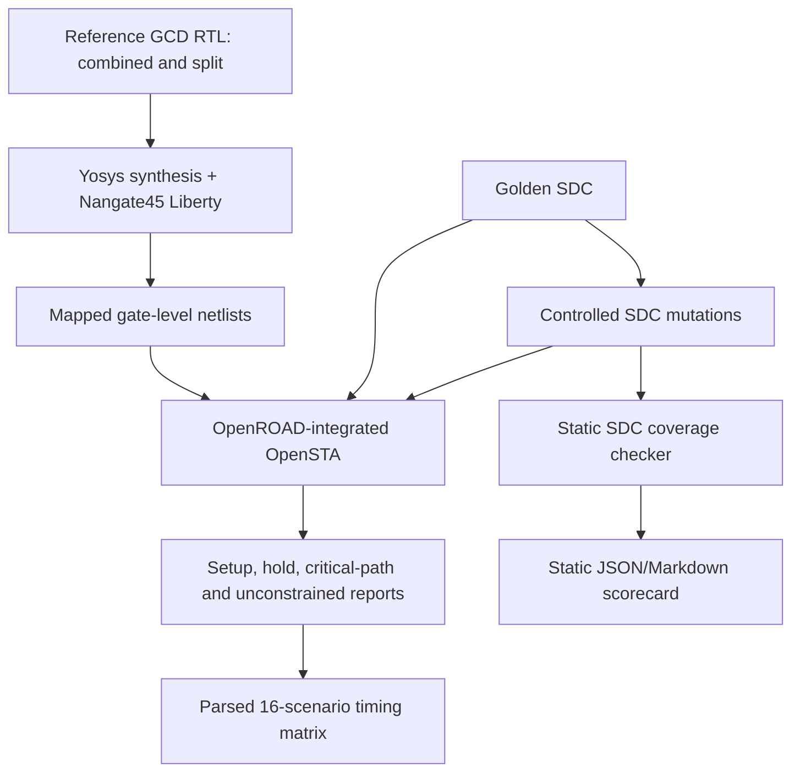

[](https://github.com/arshath-007/timingforge-gcd-sta-lab/actions/workflows/rtl-regression.yml)

# TimingForge
## An Open Benchmark for Trustworthy Static Timing Analysis

**Status:** Research prototype · **Version:** 0.2.0 · **License:** MIT

> A timing report can look clean even when the constraints are incomplete. TimingForge studies whether an STA flow can identify deliberately introduced constraint defects before engineers trust its results.

TimingForge is an educational, reproducible benchmark for **constraint quality and timing-analysis trust**. It uses two 32-bit binary-GCD RTL architectures as a controlled test vehicle, injects named SDC defects, runs a conservative constraint-coverage checker, and analyses the golden/mutated constraints with a library-backed OpenROAD-integrated OpenSTA flow.

This is not a replacement for signoff STA, an official EDA signoff qualification, or a claim that an unconstrained path is automatically a silicon failure. It is a research and learning framework that makes assumptions visible and experiments reproducible.

## Why this problem matters

Static timing analysis is only as meaningful as the design model and timing constraints supplied to it. Missing clocks or I/O delays, incorrect port matches, and unjustified timing exceptions can leave paths unconstrained or excluded. A positive slack value is not sufficient evidence that all intended paths were analysed.

TimingForge makes this failure mode testable:

1. Establish a reference RTL and SDC baseline, documenting any observed setup or hold violations.
2. Generate controlled, named SDC mutations from that baseline.
3. Run static constraint-coverage checks.
4. Synthesize both RTL architectures against the same standard-cell Liberty library.
5. Run the golden and mutated SDC files through the same timing engine and netlist.
6. Compare setup/hold results, unconstrained endpoints, critical paths, and register-to-register path coverage.
7. Publish every assumption and result rather than inventing PPA numbers.

## Architecture



The static checker is a conservative, interface-specific prototype—not a full SDC Tcl parser. The library-backed matrix uses Yosys, the OpenROAD-integrated OpenSTA engine, and the educational Nangate45 typical Liberty platform.

## First release

- Two synthesizable iterative binary-GCD microarchitectures: combined compare/subtract and split compare/subtract.
- A self-checking SystemVerilog testbench using a Euclidean-algorithm reference model.
- A documented 10 ns block-level SDC example with setup/hold uncertainty and min/max I/O delays.
- Seven controlled SDC mutation cases:
  - M01 missing primary clock.
  - M02 missing input delay.
  - M03 missing output delay.
  - M04 broad register-to-register false-path exception.
  - M05 near-match/incorrect port collection.
  - M06 missing hold clock uncertainty.
  - M07 non-positive clock period.
- Static SDC coverage checker, fault generator, JSON/Markdown scorecard, and Python unit tests.
- Yosys synthesis scripts and a library-backed OpenROAD-integrated STA matrix runner.
- STA report parser that summarises area, minimum clock period, Fmax, worst setup/hold slack, WNS/TNS, register-to-register path presence, and unconstrained endpoints.
- GitHub Actions regression and library-backed STA jobs.

## Repository layout

```text
rtl/             synthesizable GCD architectures
tb/              self-checking SystemVerilog testbench
constraints/     golden SDC
tools/           fault injector, SDC linter, benchmark and STA parser
tests/           Python unit tests
scripts/         Yosys synthesis and OpenSTA/OpenROAD entry points
docs/            scope, fault catalog, learning path and measured results
reports/         generated reports (not committed by default)
.github/         automated RTL/Python and library-backed STA workflows
```

## Quick start

### 1. Functional RTL regression

Requirements: Icarus Verilog with SystemVerilog support.

```bash
make rtl-test
```

### 2. Static SDC fault-injection benchmark

Requirements: Python 3.10+.

```bash
make mutants
make lint-sdc
make python-test
make benchmark
```

Generated SDC files are written under `build/mutants/`. The checker validates simple expected clock, setup/hold uncertainty, and min/max I/O-delay patterns for the GCD interface. The benchmark writes JSON and Markdown scorecards under `build/`; its score covers seven controlled pattern/coverage mutations only, not general SDC correctness or signoff.

### 3. Library-backed synthesis and timing matrix

Requirements: OpenROAD Flow Scripts environment with Yosys, OpenROAD-integrated OpenSTA, Python 3, and curl.

```bash
source /OpenROAD-flow-scripts/env.sh
make sta-matrix
```

The script downloads the Nangate45 typical Liberty and two LEF files from a pinned OpenROAD Flow Scripts source revision when they are not present. It synthesizes both GCD architectures and runs the golden SDC plus seven mutations through the timing engine (16 STA runs total). It then writes:

- `build/reports/sta_matrix_summary.md`
- `build/reports/sta_matrix_summary.json`
- Raw STA logs in `build/reports/`
- Yosys synthesis logs in `build/`

The summary includes Yosys cell area, minimum period, corresponding Fmax, worst setup/hold slack, WNS/TNS, register-to-register path presence, missing I/O-delay warnings, and unconstrained endpoints. Set `STA=sta` to use a standalone OpenSTA executable instead of the default `openroad` command where a compatible standalone binary and LEF-independent setup are available.

### 4. Manual synthesis and STA

For a locally configured standard-cell library:

```bash
export LIBERTY=/absolute/path/to/your/stdcells.lib
make synth
export NETLIST=build/gcd_binary_combined.v
export SDC=constraints/gcd_baseline.sdc
make sta
```

Review the raw Yosys/OpenSTA logs and tool versions. A successful script exit alone is not a substitute for understanding the reported paths and constraints.

## Verified evidence

The baseline numerical measurements and raw matrix artifacts originate from run ID `41999231060` (workflow run #69, source commit `bd29bcd96914f0415771aa5aa76949cf7163b66e`). The latest CI validation is run ID `42007925745` (workflow run #82, source commit `18121a4848825c23a878702712e1bf6b86099cf3`); both regression and library-backed STA jobs passed. The latter validates the documentation revision and workflow execution; it does not replace the original baseline measurements.

- 258 directed/random GCD input pairs checked on **each** RTL architecture.
- 13 Python unit tests passed.
- Seven controlled static SDC fault patterns detected by the prototype.
- Both architectures synthesized against the pinned Nangate45 typical Liberty file.
- Eight SDC scenarios analysed for each architecture (16 STA log files).
- RTL operation latency measured: combined average 63.63 cycles (maximum 93); split average 84.17 cycles (maximum 124).
- Raw logs and parsed timing matrix uploaded as [STA evidence](https://github.com/arshath-007/timingforge-gcd-sta-lab/actions/runs/41999231060/artifacts/13401821413); static benchmark scorecard uploaded [here](https://github.com/arshath-007/timingforge-gcd-sta-lab/actions/runs/41999231060/artifacts/13402245334).

**Measured first baseline results:** the combined architecture reported 1657.180 Yosys Liberty area units, 2.94 ns all-path minimum period (including port paths), 340.67 MHz corresponding all-path Fmax, +7.065 ns worst setup slack, and -0.002 ns worst hold slack. The split architecture reported 1681.918 area units, 2.35 ns all-path minimum period, 425.57 MHz corresponding all-path Fmax, +7.650 ns worst setup slack, and +0.005 ns worst hold slack. These minimum-period/Fmax values come from `report_clock_min_period -include_port_paths`; they are not register-to-register-only architecture metrics. The dedicated register-to-register report records path presence but this release does not publish a separate register-to-register minimum period. In the same 258-case RTL test corpus, average operation latency was 63.63 cycles combined versus 84.17 cycles split (maximum 93 vs 124). Do not interpret the all-path Fmax comparison as a pure internal-logic comparison or as measured application throughput. These are not production or post-route PPA figures.

See [Initial measured results](docs/INITIAL_RESULTS.md), [baseline measurement run ID 41999231060](https://github.com/arshath-007/timingforge-gcd-sta-lab/actions/runs/41999231060), and [latest CI validation run ID 42007925745](https://github.com/arshath-007/timingforge-gcd-sta-lab/actions/runs/42007925745).

## Research questions

- Does the checker detect each mutation that it is designed to recognise?
- Can a timing exception hide register-to-register paths that are present under the golden SDC?
- Can missing I/O delays cause paths to become unconstrained or make the apparent minimum period look better?
- How do critical path, setup slack, hold slack, and unconstrained endpoints change between scenarios?
- How do the combined and split GCD architectures trade logic depth against cycle count and cell area?
- Which checks can be automated safely, and which require design intent or engineer review?

## Current limitations

- The Python linter is a first-pass line/pattern-based checker, not a full SDC parser or proof of constraint correctness.
- A false-path statement is flagged for review; a broad false-path test is only a controlled negative experiment. The tool does not decide whether a real exception is valid without design intent.
- The first SDC is an illustrative block-level budget, not a product specification.
- The current library-backed result uses one typical Nangate45 corner, ideal clocks, and no SPEF/extracted interconnect parasitics. It is pre-layout and not signoff.
- No full physical implementation, CTS, route, MMMC/PVT, OCV/AOCV/POCV, crosstalk/SI, or timing ECO closure is claimed yet.
- The educational Nangate45 platform is not a modern production process or signoff reference.
- No power measurement is claimed.

## Prior art and positioning

TimingForge builds on existing open-source EDA infrastructure rather than competing with it:
- [OpenSTA](https://github.com/The-OpenROAD-Project/OpenSTA) performs static timing analysis.
- [Yosys](https://github.com/YosysHQ/yosys) performs RTL synthesis.
- [OpenROAD](https://github.com/The-OpenROAD-Project/OpenROAD) provides physical-design implementation flows.
- Existing SDC lint and constraint-analysis projects already address parts of constraint validation.

The intended project contribution is a **reproducible fault-injection benchmark that links named SDC defects to both static checker findings and library-backed STA observations**. This is a differentiated project direction, not a claim of global novelty. The prior-art review should be expanded as the project matures.

## Roadmap

- [x] Two synthesizable GCD architectures.
- [x] Self-checking functional regression.
- [x] Golden SDC with explicit setup/hold and min/max I/O assumptions.
- [x] Seven controlled SDC mutation scenarios and unit tests.
- [x] Static SDC checker and machine-readable scorecard.
- [x] Yosys synthesis against a documented/pinned Liberty platform.
- [x] OpenROAD-integrated STA matrix for both architectures and all eight SDC scenarios.
- [x] Parsed STA matrix report and initial measured results.
- [ ] Add FIFO and MAC benchmark blocks.
- [ ] Add generated-clock, multicycle, clock-group, and justified false-path scenarios.
- [ ] Add additional corners and variation-aware experiments.
- [ ] Add OpenROAD floorplanning, placement, CTS, routing, and parasitic-aware reports.
- [ ] Validate findings with external contributors and maintainers.

## Contributing and citation

See [CONTRIBUTING.md](CONTRIBUTING.md), [CITATION.cff](CITATION.cff), [docs/PROJECT_SCOPE.md](docs/PROJECT_SCOPE.md), [docs/FAULT_CATALOG.md](docs/FAULT_CATALOG.md), and the [technical interview walkthrough](docs/INTERVIEW_GUIDE.md).

## Author

Maintained by [arshath-007](https://github.com/arshath-007).

**Recruiter-facing note:** The goal is to demonstrate engineering method—clear assumptions, functional verification, SDC reasoning, tool use, reproducibility, and honest interpretation—not to claim production signoff experience.
