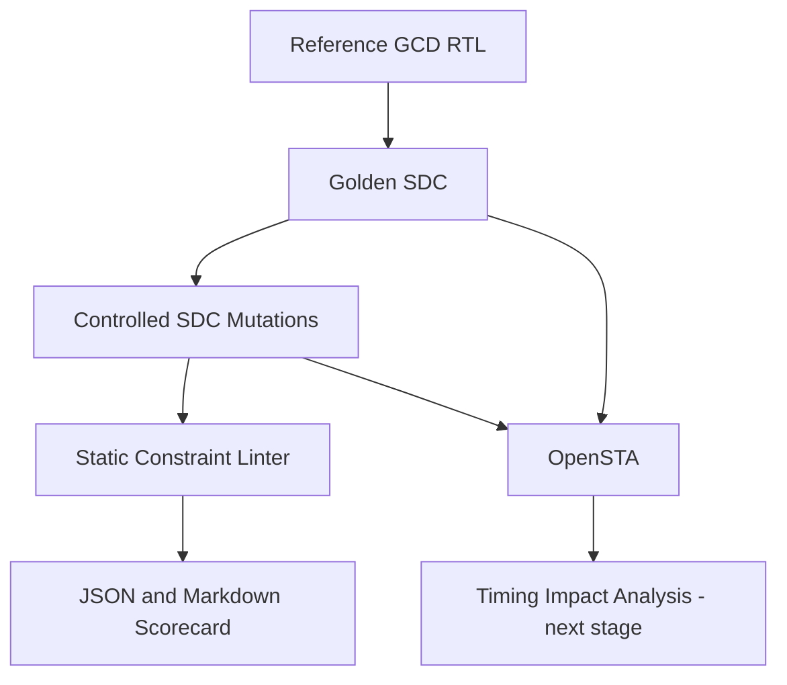

[](https://github.com/arshath-007/timingforge-gcd-sta-lab/actions/workflows/rtl-regression.yml)

# TimingForge
## An Open Benchmark for Trustworthy Static Timing Analysis

**Status:** Early research prototype · **Version:** 0.1.0 · **License:** MIT

> A timing report can look clean even when the constraints are incomplete. TimingForge studies whether an STA flow can identify deliberately introduced constraint defects before engineers trust its results.

TimingForge is an educational, reproducible benchmark for **constraint quality and timing-analysis trust**. It starts with a small binary-GCD accelerator so that RTL behaviour is easy to verify, then injects controlled SDC defects and compares what a lightweight checker and an STA engine report.

This is not a replacement for signoff STA, an official EDA signoff qualification, or a claim that an unconstrained path is automatically a silicon failure. It is a research and learning framework that makes assumptions visible.

## Why this problem matters

Static timing analysis is only as meaningful as the design model and timing constraints supplied to it. Missing clocks or I/O delays, incorrect port matches, and unjustified timing exceptions can leave paths unconstrained or excluded. A positive slack value is not sufficient evidence that all intended paths were analysed.

TimingForge makes this failure mode testable:

1. Establish a known-good RTL and SDC baseline.
2. Generate controlled, named SDC mutations.
3. Run static constraint checks.
4. Where a Liberty library and OpenSTA are available, run STA on each scenario.
5. Compare detected defects, unconstrained paths, and timing results.
6. Publish every assumption and result rather than inventing PPA numbers.

## Architecture



The static linter and scorecard are implemented. OpenSTA integration scripts are present, but actual library-backed timing runs and parsed timing-impact comparisons remain future work.

## First release

- Two synthesizable iterative binary-GCD microarchitectures: combined compare/subtract and split compare/subtract.
- A self-checking SystemVerilog testbench using a Euclidean-algorithm reference model.
- A documented 10 ns block-level SDC example.
- Four controlled SDC mutation cases: missing clock, missing input delay, missing output delay, and a broad false-path exception.
- A small Python SDC-lint prototype and unit tests.
- Yosys and OpenSTA run scripts. Tool runs require a user-supplied Liberty file and are not claimed as completed.

## Repository layout

```text
rtl/             synthesizable GCD architectures
tb/              self-checking SystemVerilog testbench
constraints/     golden SDC
tools/           fault injector and static SDC lint prototype
tests/           Python unit tests
scripts/         Yosys synthesis and OpenSTA entry points
docs/            scope, methodology, learning notes
reports/         generated reports (not committed by default)
.github/         automated RTL/Python regression
```

## Quick start

### 1. Functional RTL regression

Requirements: Icarus Verilog with SystemVerilog support.

```bash
make rtl-test
```

### 2. SDC mutation experiment

Requirements: Python 3.10+.

```bash
make mutants
make lint-sdc
make python-test
make benchmark
```

Generated SDC files are written under `build/mutants/`. The linter is intentionally conservative and specific to the GCD interface. The benchmark produces JSON and Markdown scorecards under `build/`; its score covers seven controlled pattern/coverage mutations only, not general SDC correctness or signoff.
### 3. Library-backed synthesis and timing matrix

For a reproducible educational run using the Nangate45 typical Liberty library and an OpenROAD Flow Scripts environment with Yosys/OpenROAD available:

```bash
source /OpenROAD-flow-scripts/env.sh
make sta-matrix
```

The script downloads the Nangate45 typical Liberty file from the OpenROAD Flow Scripts platform repository when it is not already present, synthesises both GCD architectures, and runs the golden SDC plus seven generated mutations through the OpenROAD-integrated STA engine. It then writes `build/reports/sta_matrix_summary.md` and `.json`, including setup/hold WNS/TNS, setup-WNS deltas against the golden case, and unconstrained paths reported. Set `STA=sta` to use a standalone OpenSTA executable instead of the default `openroad` command. Nangate45 is an educational platform; the run is pre-layout without SPEF and is not portable to a production process or signoff flow.

### 4. Manual synthesis and STA


Requirements: Yosys, OpenSTA, and a compatible standard-cell Liberty file.

```bash
export LIBERTY=/absolute/path/to/your/stdcells.lib
make synth
export NETLIST=build/gcd_binary_combined.v
export SDC=constraints/gcd_baseline.sdc
make sta
```

The synthesis script is a starting point, not a guarantee that every Liberty library will map without library-specific adjustments. Review the Yosys/OpenSTA logs and tool versions.

## Verified CI evidence

The latest **static regression** has passed:
- 258 directed/random test cases checked on both GCD architectures.
- 10 Python unit tests passed.
- Golden SDC clock, setup/hold uncertainty, and min/max I/O-delay pattern checks passed.
- 7 of 7 controlled static mutation patterns were detected by the prototype.

A separate library-backed Yosys/OpenROAD timing job is now configured to synthesise both architectures and analyse the golden SDC plus seven mutations with the educational Nangate45 typical library. Its results must be inspected in GitHub Actions before marking that milestone complete.

## Research questions

- Does the checker detect each mutation that it is designed to recognise?
- Can a timing exception hide paths that are timed in the golden scenario?
- How do critical path, setup slack, hold slack, and unconstrained endpoints change between scenarios?
- How do the combined and split GCD architectures trade logic depth against cycle count and cell area?
- Which checks can be automated safely, and which require design intent or engineer review?

## Current limitations

- The Python linter is a first-pass ruleset, not a full SDC parser or proof of constraint correctness.
- A false-path statement is flagged for review; the checker does not decide whether it is valid without design intent.
- Real timing numbers depend on the Liberty library, synthesis settings, wire/parasitic model, and STA tool version.
- The first SDC is an illustrative block-level budget, not a product specification.
- Multi-mode/multi-corner analysis, propagated clocks, extracted parasitics, OCV/AOCV/POCV, SI, and ECO flows are future extensions.

## Prior art and positioning

TimingForge builds on existing open-source EDA infrastructure rather than competing with it:
- [OpenSTA](https://github.com/The-OpenROAD-Project/OpenSTA) performs static timing analysis.
- [Yosys](https://github.com/YosysHQ/yosys) performs RTL synthesis.
- [OpenROAD](https://github.com/The-OpenROAD-Project/OpenROAD) provides physical-design implementation flows.
- Existing SDC lint and constraint-analysis projects already address parts of constraint validation.

The project's intended contribution is a **reproducible fault-injection benchmark that links named constraint defects to expected checker findings and, later, measured STA consequences**. This positioning is a research hypothesis, not a claim of global novelty. A prior-art review is required before making stronger novelty claims.

## Roadmap

- [x] Initial RTL benchmark and two architectures
- [x] Self-checking functional testbench
- [x] Golden SDC example
- [x] Four controlled SDC mutation scenarios
- [x] Static SDC lint prototype and unit tests
- [ ] Execute RTL and Python regressions locally and attach logs
- [ ] Run Yosys/OpenSTA with a documented Liberty platform
- [ ] Parse STA reports into machine-readable measurements
- [ ] Add FIFO and MAC benchmark blocks
- [ ] Add multiple clock scenarios and justified exception tests
- [ ] Add OpenROAD physical implementation and parasitic-aware experiments
- [ ] Publish a technical case study with reproducible results

## Contributing

See [docs/PROJECT_SCOPE.md](docs/PROJECT_SCOPE.md) before proposing new checks. Contributions should include a defect definition, expected finding, negative/control case, test, and limitations.

## Author

Maintained by [arshath-007](https://github.com/arshath-007).

**Recruiter-facing note:** The goal is to demonstrate engineering method—clear assumptions, functional verification, SDC reasoning, tool use, reproducibility, and honest interpretation—not to claim production signoff experience.
