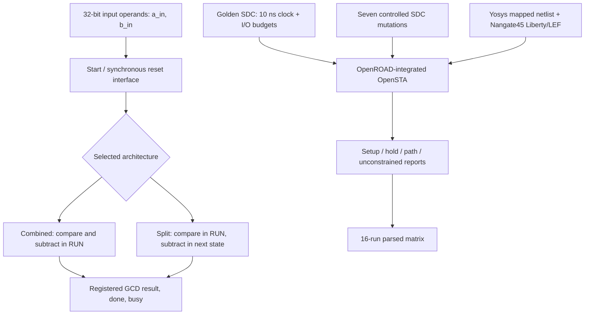

# TimingForge Architecture and STA Report Walkthrough

## 1. Benchmark architecture



The two GCD architectures implement the same synchronous interface and are compared using the same synthesis library, clock and SDC baseline. The combined implementation performs the odd-operand comparison and subtraction in one RUN cycle. The split implementation registers the comparison result and performs subtraction in a following state.

## 2. What the timing report means

- **Startpoint / endpoint:** identify the launching pin and capturing pin of the reported timing path.
- **Data arrival time:** accumulated input delay, cell delay and net delay at the endpoint.
- **Data required time:** capture-clock edge adjusted for clock uncertainty and the library setup requirement.
- **Setup slack:** required time minus arrival time. Positive is met; negative is a setup violation.
- **Hold slack:** minimum-delay margin. Positive is met; negative indicates a hold violation.
- **WNS / TNS:** worst negative slack and total negative slack. Read these alongside worst slack; WNS can be zero when all checks pass.
- **Unconstrained endpoints:** endpoints for which the intended timing constraints are incomplete or absent. A clean-looking constrained report is not sufficient if intended paths are unconstrained.

## 3. Evidence-based combined-architecture investigation

In the v0.2.0 baseline log, the combined architecture has a same-clock rising-edge register path:

- Launch: `_2213_`
- Capture: `_2247_`
- Data arrival: 1.399 ns
- Data required: 9.813 ns
- Reported setup slack: 8.414 ns

The same baseline run reports `report_clock_min_period` as `0.00 / inf` for the combined architecture, while the split architecture reports 0.740 ns. This is an inconsistency between the command summary and detailed path evidence; it is not proof that the combined architecture has no register paths or infinite operating frequency.

The follow-up diagnostic adds explicit rising-edge and falling-edge register-to-register path queries. The correct next step is to compare their complete path inventory and endpoint coverage with the clock-min-period result. Do not derive or publish an internal Fmax until the query is understood and independently validated.

## 4. Known baseline results and limitations

| Metric | Combined | Split |
|---|---:|---:|
| Yosys cell area | 1657.180 | 1681.918 |
| All-path minimum period | 2.94 ns | 2.35 ns |
| All-path Fmax | 340.67 MHz | 425.57 MHz |
| Worst setup slack | +7.065 ns | +7.650 ns |
| Worst hold slack | -0.002 ns | +0.005 ns |
| Register-only minimum period | unavailable | 0.740 ns |

All-path figures include I/O port paths and must not be used as an architecture-only internal speed comparison. The combined architecture has a small negative hold slack under the golden SDC and is not hold-clean. The results are pre-layout, use one typical Nangate45 Liberty corner and ideal clocks, and have no extracted SPEF parasitics. They are educational benchmark results, not signoff.

## 5. Repeatable commands

```bash
make rtl-test
make python-test
make lint-sdc
make benchmark
source /OpenROAD-flow-scripts/env.sh
make sta-matrix
```

Inspect `build/reports/sta_matrix_summary.md` and the raw `build/reports/sta_*.log` files. Always retain the exact source commit and tool versions alongside the results.
