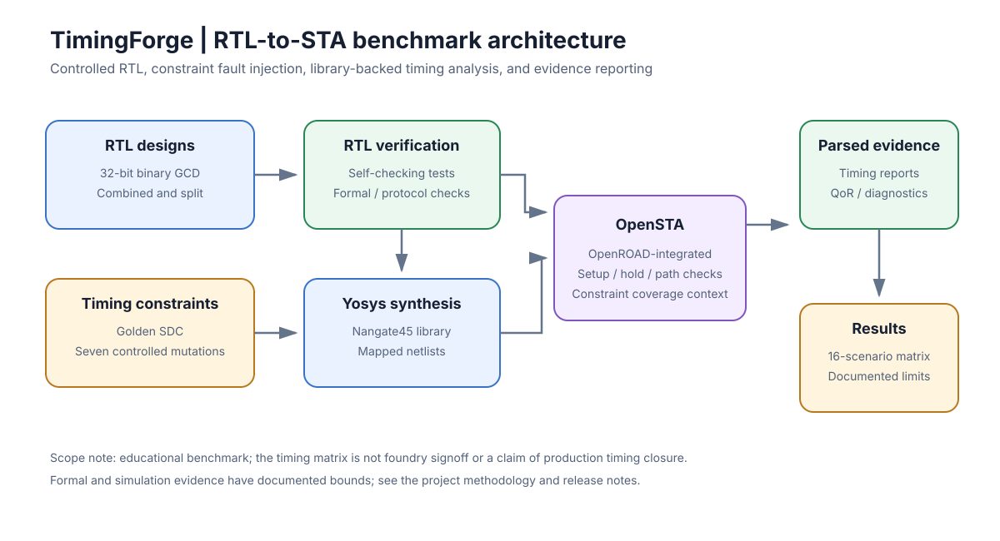
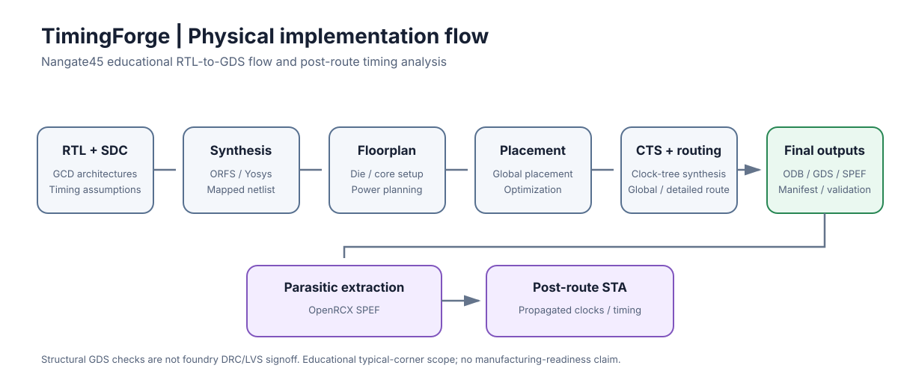
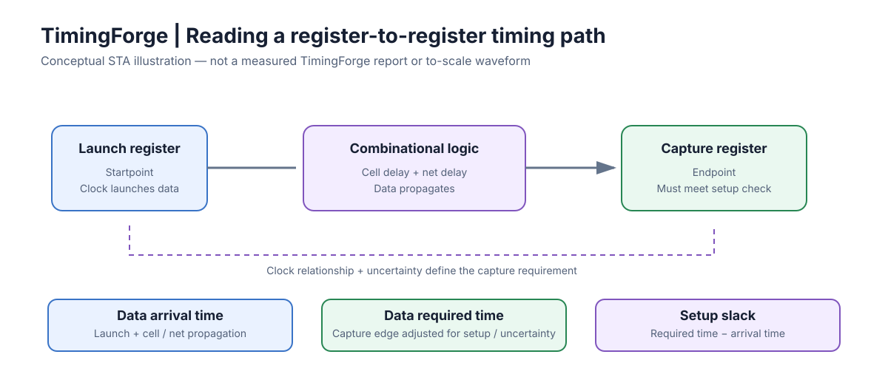

# TimingForge public diagrams

These diagrams are intentionally high-level portfolio illustrations. They explain the public benchmark structure without exposing private TrustLab research, unpublished mutation strategies, or future research plans.

## RTL-to-STA benchmark architecture

## Physical implementation flow

## Reading an STA critical path

The critical-path illustration is conceptual and is not a measured report or a to-scale waveform. The physical-flow illustration summarizes the documented educational flow; structural GDS checks are not foundry DRC/LVS signoff.

For detailed methodology, see the public [architecture and STA walkthrough](../ARCHITECTURE_AND_STA_WALKTHROUGH.md) and [physical-flow documentation](../PHASE3_PHYSICAL_FLOW.md).
